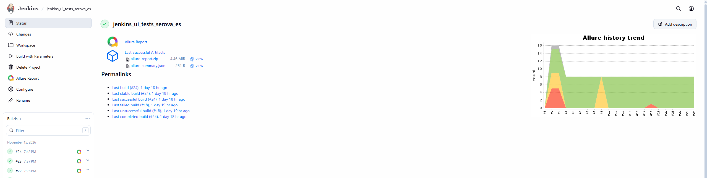
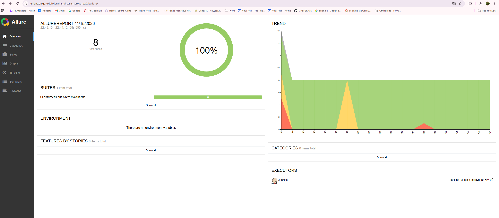
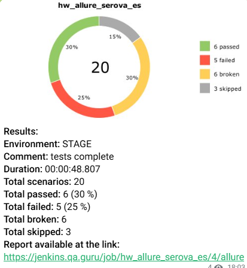

# UI-автотесты для сайта Максидома в рамках обучения автоматизации

8 UI-тестов для https://www.maxidom.ru/ с применением паттерна Page Object 

## Стек

## Сценарии

| Тест | Проверка |
| --- | --- |
| `searchReturnsRelevantProducts` | Поиск «шуруповерт»: непустая выдача и релевантное название товара |
| `searchWithUnknownQueryShowsEmptyResults` | Сообщение об отсутствии результатов и отсутствие карточек выдачи |
| `searchResultOpensMatchingProduct` | Переход в карточку, соответствие названия выбранному товару и видимая фотография |
| `productCanBeAddedToComparison` | Счётчик сравнения и наличие выбранного товара в таблице сравнения |
| `newVisitorHasEmptyCart` | Переход в корзину и сообщение о пустой корзине |
| `catalogOpensPowerToolsCategory` | Переход из каталога в «Электроинструмент», заголовок и подраздел «Дрели» |
| `loginMethodCanBeSwitched` | Переключение полей телефона и почты в форме входа в обе стороны |
| `passwordVisibilityCanBeToggled` | Показ/скрытие пароля с сохранением введённого значения |

##  Сборка в Jenkins

Для запуска сборки необходимо перейти в раздел <code>Собрать с параметрами</code> и нажать кнопку <code>Собрать</code>.

[Ссылка на сборку Jenkins](https://jenkins.qa.guru/job/jenkins_ui_tests_serova_es/)

##  Пример Allure-Report

[Ссылка на Allure-отчёт](https://jenkins.qa.guru/job/jenkins_ui_tests_serova_es/24/allure/)

##  Пример уведомления в Telegram

[Ссылка на Telegram-канал](https://t.me/forhomeworksqa)

##  Пример запуска в Selenoid

